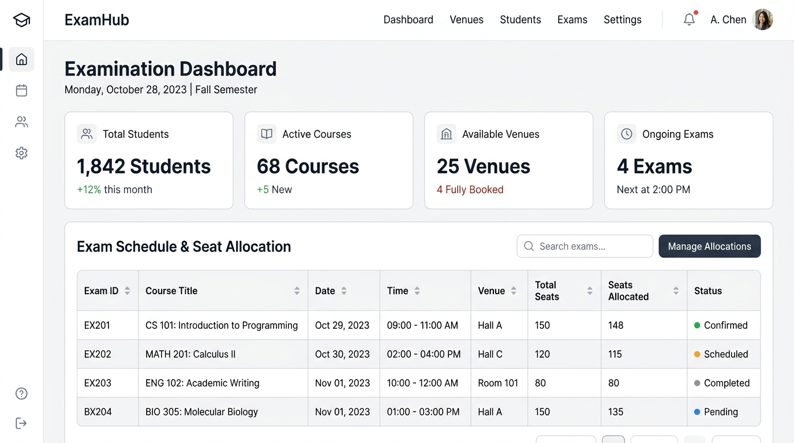

# Examination Venue & Seat Allocation System

**An automated examination operations engine designed to eliminate scheduling clashes, balance invigilator duty loads, and enforce 1-hour time-locked student seat concealment.**



[](https://www.python.org/)
[](https://www.djangoproject.com/)
[](https://www.sqlite.org/)
[](https://developer.mozilla.org/en-US/docs/Web/HTML)
[](https://developer.mozilla.org/en-US/docs/Web/CSS)
[](https://opensource.org/licenses/MIT)

---

## Key Features

* **Automated Conflict / Clash Detection**: Validates student course registrations before timetable publication to prevent scheduling overlapping exams for the same student.
* **Least-Used Load Balancing**: Dynamically assigns exam venues and invigilators using a least-used-first strategy to prevent room overcrowding and staff burnout.
* **1-Hour Time-Locked Venue Reveal**: Conceals hall names and seat numbers from students until exactly 60 minutes prior to exam commencement.
* **Role-Based Portals**:
  * **Exam Officers**: Central console for managing students, courses, venues, invigilators, and executing batch allocations.
  * **Invigilators**: Dedicated desk for tracking supervision assignments and accessing hall attendance sheets.
  * **Students**: Personal desk displaying registered courses and active seat allocations.
* **Printable Seating Charts**: Generates printer-optimized door rosters and invigilator verification sheets with signature blocks.
* **CSV Bulk Import Hub**: Batch ingest students, curriculum catalogs, invigilator rosters, and draft timetables via standard CSV files.

---

## Quick Start

### 1. Clone & Set Up Environment

```bash
git clone https://github.com/hauwamk/allocationsystem.git
cd allocationsystem

python3 -m venv venv
source venv/bin/activate  # Windows: venv\Scripts\activate
pip install -r requirements.txt
```

### 2. Initialize Database & Seed Demo Data

```bash
python manage.py migrate
python manage.py seed_demo_data
```

### 3. Launch the Server

```bash
python manage.py runserver
```

Open [http://127.0.0.1:8000/](http://127.0.0.1:8000/) in your browser.

---

## Default Roles & Test Credentials

The `seed_demo_data` command creates pre-configured accounts for local testing:

| Role | Username / ID | Password | Portal URL |
| :--- | :--- | :--- | :--- |
| **Superadmin** | `admin` | `admin123` | `/accounts/staff/login/` |
| **Exam Officer** | `officer1` | `officer123` | `/accounts/staff/login/` |
| **Invigilator** | `STAFF/0101` | `STAFF/0101` | `/accounts/invigilator/login/` |
| **Student** | `CST/22/COM/001` | `CST/22/COM/001` | `/accounts/login/` |

---

## Advanced Setup & CSV Import Specifications

<details>
<summary><strong>View CSV Import Headers & Specifications</strong></summary>

### 1. Student Directory (`/students/import/`)
```csv
registration_number,first_name,last_name,department,level,gender,email
CST/22/COM/001,Amina,Ibrahim,COM,200,F,amina@buk.edu.ng
```

### 2. Course Catalog (`/courses/import/`)
```csv
Course Code,Course Title,Department,Level,Semester
COM201,Data Structures and Algorithms,COM,200,First
MTH201,Linear Algebra,ALL,200,First
```
* *Department aliases supported: `COM`/`CS`, `SWE`/`SE`, `IFT`/`IT`, `CBS`/`CY`, `ALL`.*

### 3. Invigilator Roster (`/invigilators/import/`)
```csv
Staff ID,Full Name,Phone Number
STAFF/0101,Dr. Haruna Musa,08031234567
```

### 4. Timetable Batch (`/exams/timetables/<id>/upload/`)
```csv
Course Code,Date,Time,Duration
COM201,2026-11-16,09:00,120
```

</details>

<details>
<summary><strong>View Environment Configurations & Production Notes</strong></summary>

* **Database Engine**: Uses SQLite (`db.sqlite3`) for zero-configuration local runs. For high-concurrency production deployments, swap the `DATABASES` dictionary in `exam/settings.py` to PostgreSQL (`django.db.backends.postgresql`).
* **Session Security**: Ensure `DEBUG = False`, define strict `ALLOWED_HOSTS`, and set `CSRF_COOKIE_SECURE = True` along with `SESSION_COOKIE_SECURE = True` behind an HTTPS reverse proxy (Nginx).

</details>

---

## Testing

Run the automated test suite across all modules:

```bash
python manage.py test
```
